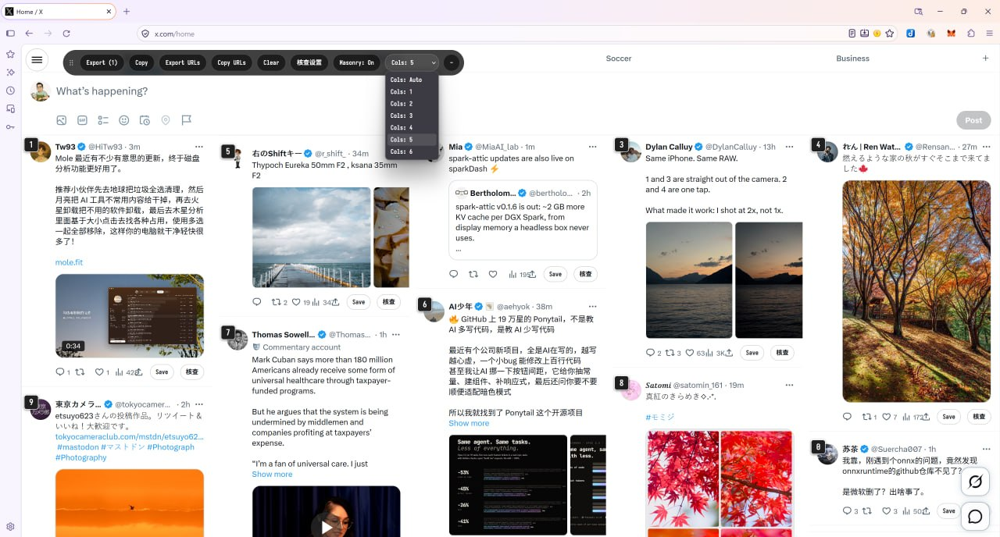

# X Post Saver (Enhanced)

Save X posts in your browser, export them as JSONL or a list of URLs, and browse
supported timelines in a responsive masonry layout.

**[Install X Post Saver 0.6.4](https://raw.githubusercontent.com/lsj5031/XPostSaver/master/x-post-saver-enhanced.user.js)** · [Changelog](CHANGELOG.md)

## Quick start

1. Install a userscript manager such as [Tampermonkey](https://www.tampermonkey.net/)
   (recommended), [Violentmonkey](https://violentmonkey.github.io/), or
   [Greasemonkey](https://www.greasespot.net/). Open the install link above and
   confirm in your manager. Masonry is built in; disable or remove the separate
   X.com Masonry View script if you have it.
2. Open X.com and click **Save** on a post to keep it. Click **Saved** to remove
   it from your local list.
3. Open the floating bookmark circle. **Export (N)** downloads a
   [JSONL file](#jsonl-format) and **Copy** copies the same data. For just the
   post links, use **Export URLs** or **Copy URLs**. **Clear** removes all saves
   after confirmation.

Drag the circle or the expanded panel’s six-dot grip to move it. The panel
remembers its position and starts collapsed on each page load.

**Masonry preview:** The X feed in five columns with **Cols: 5** selected.



## Masonry

**Masonry: On** is the default. In the expanded bookmark panel, choose
**Masonry: Off** to return to X’s native layout. **Cols: Auto** chooses a
column count from the available feed width. Choose a maximum of **1–6** to cap
it: a narrower feed can still use fewer columns, and **1** caps it at one.
Both settings apply without reloading and are remembered independently.

With masonry active in landscape windows at least 1,000 px wide, the feed
uses the available width and **☰** opens X’s navigation drawer. Post detail
pages, windows under 700 px, and unsupported feeds keep X’s native layout
even if the setting is On. If a timeline misbehaves, switch Masonry off.
The browser fixtures model X offline, not a live account or every
browser/userscript-manager combination. X UI changes can affect compatibility.
See the [third-party notices](THIRD_PARTY_NOTICES.md) for masonry attribution.

## Keyboard shortcuts

| Key | Action |
| --- | --- |
| **j** / **k** | Focus the next / previous post. If no post is focused on screen, start at the first / last visible post. |
| **w** | Open the focused post in a background tab. |
| **v** | Toggle **Save** / **Saved** on the focused post. |
| **c** | Run **核查** on the focused post and automatically send its prompt to Grok Auto. |
| **1–9**, **0**, then **d/e/q/y/z** | Press the badge shown on a visible masonry card to open that post in a background tab without moving focus. |
| **Space** / **Shift+Space** | Scroll down / up one viewport. |

Hovering alone does not focus a post. Badges appear only on eligible visible
cards with a verified link to the post itself. Unassigned badge keys and X’s
native **x** (Block) pass through. Shortcuts leave typing fields, dialogs, and
media controls alone. Background tabs require the userscript manager’s
`GM_openInTab` permission; there is no foreground fallback.

## Optional: fact-check with Grok

Click **核查** (fact-check) beside **Save**, or press **c** on a focused post,
to **automatically send** a prompt to Grok in Auto mode through X’s own UI.
This is opt-in per post and requires a signed-in X account with Grok access.
The prompt includes the post URL, currently loaded text, and one level of
quoted context. Use **核查设置** in the panel to edit the default Chinese
prompt template.

If handoff stops before sending, use **复制提示词** to copy the prompt. The
script won’t replace or send an existing draft. If the send outcome is
uncertain, check the Grok conversation before sending anything again; the
script does not retry or archive Grok responses.

## Local storage and privacy

Saved posts and preferences stay in your browser’s userscript storage, with
local browser storage as a fallback. Saving and exporting do not use an
external API. Exports include post text and available links, media URLs
(not media files), and one level of quoted-post data. The script warns at
1,800 saves and blocks new saves at 2,000; export a backup before clearing.

No Grok requests run in the background. If the prompt is sent, X/Grok
processes it under your account and its policies. The automatic handoff
does not use the system clipboard; the fallback copy button does.

## JSONL Format

Each line is one JSON object.

Example:

```json
{"id":"123456789","url":"https://x.com/user/status/123456789","author":"User Name","handle":"@username","text":"Post text","date":"2026-01-20T12:00:00.000Z","saved_at":"2026-01-20T12:30:00.000Z","links":["https://example.com"],"media":[{"type":"photo","url":"https://pbs.twimg.com/media/..."}],"quoted":null}
```

Top-level fields:

- `id`: status ID (string; may be empty if not derivable)
- `url`: canonical post URL
- `author`: display name
- `handle`: username with `@`
- `text`: extracted post text
- `date`: post datetime from X
- `saved_at`: timestamp when saved locally
- `links`: external links array
- `media`: array of `{ type, url }`
- `quoted`: nested quoted post object or `null`

## Development

```bash
npm ci
node scripts/build.js  # rebuild the userscript from src/
npm run build:check    # verify the checked-in bundle
npm run check          # lint, type-check, and test
```

To regenerate the embedded font CSS, run `npm run build` with `pyftsubset`
(FontTools with Brotli support), then run `node scripts/build.js` to rebuild
the bundle with the third-party notices.

Optional offline Chromium fixtures use local Playwright and Chromium.
Set `XPS_EVIDENCE` to direct screenshots and measurements to a directory.

```bash
export XPS_PLAYWRIGHT="/absolute/path/to/playwright-core/index.js"
export XPS_CHROMIUM="/absolute/path/to/chromium"

node scripts/check-panel-browser.js
node scripts/check-navigation-browser.js
node scripts/check-masonry-columns-browser.js
node scripts/check-standalone-masonry-browser.js
node scripts/check-masonry-activation-browser.js
node scripts/check-masonry-geometry-browser.js
node scripts/check-masonry-scroll-browser.js
node scripts/check-masonry-browser.js
node scripts/check-masonry-quotes-browser.js --standalone
```

## License

Provided as-is for personal use.

The [retired Rust converter](https://github.com/lsj5031/XPostSaver/tree/0b54011498e965f5606869153f400b8fcb093425/tools/xps-render-rs) remains available in Git history.
